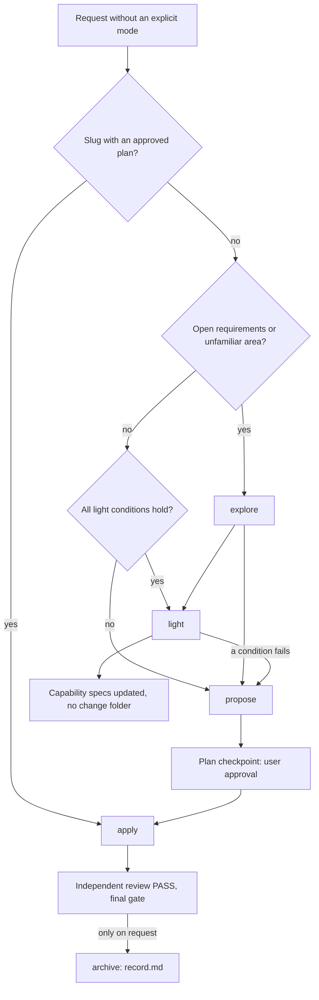

# Lifecycle

[Русский](../../ru/concepts/lifecycle.md)

Specadoc moves one change through a fixed sequence of modes. Each mode has one
job and ends at a defined stop. Specadoc starts only when you name it or one of
its modes. It does not apply itself to ordinary coding work.

There are five modes. `explore`, `propose`, `apply` and `archive` form the full
lifecycle. `light` is a short path for a small change that fits one session.

In the commands below, `<skill-root>` is the installed `skills/specadoc` folder.

## The flow

An explicit mode skips the selection at the top. `archive` is never selected
automatically.

## explore

`explore` establishes facts and tests the idea before anyone writes files. It
produces evidence in the conversation, not in the repository.

The controller first looks for capability specs that match the request. It
reads at most three of them and never reads the archive, because archive records
are closed history. When the code and a capability spec disagree, the code wins
and the drift is reported.

For a wide or unfamiliar area, the controller sends one read-only `scout` with
one concrete question. The threshold is about five files or 400 lines of reading.
After the facts are stable, a grilling skill can stress-test the idea. The
controller uses it when more than one material question is open or the evidence
conflicts. It also uses it when the change touches a public contract, schema,
security, concurrency or money.

The result is a decision log, safe defaults and at most three material
questions for you.

## propose

`propose` turns the accepted evidence into two files in the change folder:
`spec.md` and `plan.md`. It reuses `explore` evidence and does not repeat the
reconnaissance.

The sequence is:

1. A scout maps the code to change. `init_change.py` creates the change folder.
2. The controller fills the spec: requirements, acceptance scenarios,
   non-goals, constraints, assumptions and capability operations.
3. The spec gate runs (`validate_change.py <slug> --phase spec`).
4. The controller writes a small ordered set of tasks, usually three to eight.
   Each task gets an owner: `worker` or `controller`.
5. If the plan adds new non-test files, the design gate runs.
6. The plan gate runs (`--phase plan`). The controller shows a compact preview
   with the role bindings and the observed context size.
7. The lifecycle stops for your plan approval. This stop is the plan
   checkpoint.

The plan checkpoint is the only approval stop in the full lifecycle. An
explicit request for uninterrupted execution waives it. That request never
waives the spec or the validation gates.

See [Artifacts and gates](artifacts-and-gates.md) for the files and gates.

## apply

`apply` implements an approved plan and collects the final evidence. It refuses
to start without a validated spec and plan and a recorded approval.

For each task, the controller runs `specadoc_step.py dispatch`. A worker
implements the task with RED-GREEN-REFACTOR and writes a report. The controller
runs `accept`, which runs the task's Verification and checks the scope. Only
then does the next task start. Dispatch is not acceptance.

After the last task, the controller runs the whole test suite and the
repository gates once. Then one independent read-only `reviewer` checks the
stable diff. Confirmed findings are fixed and get one targeted re-review.

On a PASS, the controller updates the capability specs that the spec names. It
fills the archive summary and runs the final gate (`--phase final`). `apply`
does not archive. You ask for that separately.

## archive

`archive` closes a change into one compact `record.md` under
`<root>/archive/<slug>/`. It runs only on an explicit request.

Archive uses the PASS that `apply` recorded. It does not start a new review.
It first checks that the PASS still covers the current executable diff. If code,
tests or approved requirements changed after the PASS, archive stops and the
change goes back to `apply`.

A worker can do the archive run. The controller keeps the decision and checks
the result. The script publishes the record, reads it back, and only then
removes the change folder.

## light

`light` is for a small change that fits one session. It creates no change
folder, `plan.md`, `runs/` folder or archive record. It dispatches no scout or
worker. The capability specs are the durable record. The plan, the approval
and the evidence stay in the conversation.

All of these conditions must hold, and the controller checks them again when
new facts appear:

- One repository, and the work fits one session.
- Clear requirements and no open material domain question.
- No change to a contract with consumers outside the repository (a published
  API, SDK, event or shared schema).
- No change to money handling or to the permission model.
- No irreversible data effect beyond an ordinary additive migration.

The controller edits the affected capability specs in place and shows one
preview in chat. One approval covers both the spec delta and the plan. The
controller implements the change itself and runs the final verification once.

Unless the diff is trivial (one file, no behavior change), one independent
reviewer checks it. Without a subagent capability, the review gate stays
incomplete. The controller never reviews its own work.

The close adds a provenance row to each touched capability spec. There is no
archive step.

If a condition fails, `light` stops and moves to `propose`. If an open question
appears, it moves to `explore`. The approved spec delta and the accepted
evidence go forward into `spec.md`. The work does not restart.

An interrupted light change consists of the edited specs and the working tree.
The next session resumes from `git diff` and the spec delta.

For a practical comparison, see [Light or propose](../guides/light-or-propose.md).

## How a mode is picked

An explicit mode always wins. Without one, Specadoc applies these rules in
order:

1. `apply`, only for an existing slug whose plan records the plan approval.
2. `explore`, when material requirements are open or the area is unfamiliar.
3. `propose`, when any `light` condition fails.
4. `light` in all other cases, including small local fixes.

`archive` is not in this list. It always needs an explicit request.

## Continuity of an active change

After you select a change, follow-ups stay in its lifecycle. This includes
small visual fixes, verification fixes and resumed implementation. The
controller keeps one active change at a time.

While the behavioral requirements stay the same, the controller reuses the
accepted spec and plan, the scout evidence and the approvals. New evidence is
added to the existing plan. A new plan is not started.

A recorded PASS stays valid for `archive` after edits to the plan, capability
specs, the archive summary, token accounting or the archive record. Any of
these changes needs a final `apply` with a new review:

- production code, tests or migrations
- executable configuration
- public contracts
- approved requirements

A small controller follow-up can replace a worker under the routing rules. It
never replaces final verification or the independent review of a new
executable diff.

## When a new lifecycle starts

Start a new lifecycle only for a different change or for a changed behavioral
contract.

New requirements can also enter an active change. In that case the controller
reopens the specification review first and does not rewrite accepted
requirements to match the code. The next review round is then an `initial`
round with the reason `requirements`, not a `re-review`.

An archive record is closed history and is never reopened. To change archived
behavior, open a new change.

## Related pages

- [Roles](roles.md)
- [Artifacts and gates](artifacts-and-gates.md)
- [Modes reference](../reference/modes.md)
- Agent-facing detail: [explore](../../../skills/specadoc/references/explore.md),
  [propose](../../../skills/specadoc/references/propose.md),
  [apply](../../../skills/specadoc/references/apply.md),
  [light](../../../skills/specadoc/references/light.md),
  [archive](../../../skills/specadoc/references/archive.md)
