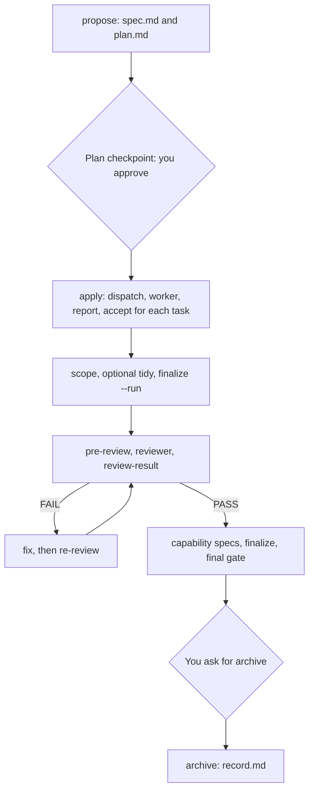

# Your first change

[Русский](../../ru/guides/first-change.md)

This guide follows one change from `propose` to `archive`. It shows what you type, which files appear, and what you decide at each stop.

The controller (your main agent session) runs the scripts. You read their output and make the decisions. The commands below show what the controller runs, so you can read the same output or run a read-only step yourself.

`<skill-root>` is the installed `skills/specadoc` folder. For how to find it, see [Install Specadoc](install.md#check-the-install).

## The example

> **Example only.** The project `shop-api`, its files and its tests are invented for this guide.

`shop-api` is a Python web service. Its `orders` table already has a `currency` column, but the public response of `GET /orders/{id}` does not show it. The request is:

> Add the order currency (ISO 4217 code) to the `GET /orders/{id}` response.

A published API changes for outside consumers, so light mode does not apply. See [Choose light, propose or explore](light-or-propose.md).

## The path



## 1. Start propose

Type the mode and the request:

- Claude Code: `/specadoc:specadoc propose Add the order currency to the GET /orders/{id} response`
- Codex plugin: `$specadoc:specadoc propose ...`, or select the skill and type `propose ...`
- Plain skill: `Use specadoc propose ...`

The controller first starts a `scout`. The scout maps the code to change and the external contract. Then the controller makes the change folder:

```bash
python3 <skill-root>/scripts/init_change.py order-currency-field --risk high --with-design --scout <scout agent id>
```

These files appear:

```text
docs/specadoc/order-currency-field/
  spec.md     stable behavioral contract
  plan.md     tasks, approvals, evidence
  design.md   only when the artifact rules need it
```

In this example the public API changes, so the rules also need `design.md`, and the controller adds `--with-design`. A `research.md` appears only when the evidence does not fit into `plan.md` in a short form. For the rules, see [Artifacts and gates](../concepts/artifacts-and-gates.md).

## 2. Read the spec

The controller fills `spec.md` and runs `validate_change.py order-currency-field --phase spec` until it passes. Read these sections:

| Section | What to look for |
|---|---|
| Goal, Non-goals | The scope you asked for, and nothing more |
| Requirements | `R1`, `R2`: observable, testable behavior. No class names or file paths |
| Acceptance scenarios | `A1` with Given, When, Then, and a `Covers:` line |
| Affected capabilities | Operations on the capability specs, for example `ADDED C4 (R1)` |
| Assumptions | The safe defaults that the agent selected for you |

An example requirement and scenario:

```markdown
### R1 — Order response shows the currency

`GET /orders/{id}` returns `currency`, the ISO 4217 code of the order.

### A1 — Existing order in euros

**Covers:** R1

- **Given:** an order with currency EUR
- **When:** a client requests `GET /orders/{id}`
- **Then:** the response contains `"currency": "EUR"`
```

If a requirement is wrong, say so now. A change to the spec after the approval needs a new approval.

## 3. Approve the plan at the checkpoint

The controller writes the tasks and runs `validate_change.py order-currency-field --phase plan`. If the plan adds new non-test files, an independent reviewer first checks the `## Class inventory` (the design gate). This example adds no new non-test file, so that gate does not apply.

Then the controller stops and shows a compact preview. The example preview has this task table:

| Task | Outcome | Files | Owner | Direction | Verification |
|---|---|---|---|---|---|
| T1 | Order response shows the currency | `app/api/orders.py`, `tests/api/test_orders.py` | worker | Add the field to the response serializer | `pytest tests/api/test_orders.py` |
| T2 | OpenAPI schema matches the response | `openapi.yaml`, `tests/contract/test_openapi.py` | worker | Add `currency` to the order schema | `pytest tests/contract/test_openapi.py` |

Under the table, the preview shows one line per role (controller, scout, worker, reviewer) with its runtime, model, effort and source file. It also shows the current context size from `status`.

Before you approve, check these items:

1. Each requirement has a task and an exact check in the requirement-to-check matrix.
2. Each task is a result that you can check on its own. "Add tests" is not a task.
3. Each `Verification` is an exact command that runs in your repository.
4. A task with `Owner: worker` has `Decision risk: low`. Other tasks stay with the controller and give a reason.
5. A check that only you or another person can run is in `External verification:`.
6. The role bindings fit the risk. The preview can include one line of binding advice.

Specadoc does not select models. A role's model and effort come from its role file. If a binding does not fit, edit the role file or `.specadoc.json` yourself. See [Routing](routing.md).

To approve, reply in chat. The controller records your words:

```bash
python3 <skill-root>/scripts/specadoc_step.py approve order-currency-field --by user --source 'Approved in chat: "go ahead"'
```

The step writes the approval into `plan.md` and stores hashes of `spec.md` and `design.md` in `runs/approval.json`. The plan checkpoint is the only approval stop. If you asked for uninterrupted work, the controller does not stop here. It still writes the spec and the plan and runs their gates.

If `status` advises a fresh session, start `apply` in a new session. The new session reads the `### Read before continuing` list in `plan.md`.

## 4. Apply

Type: `/specadoc:specadoc apply order-currency-field`.

### Tasks

For each task, the controller runs four steps:

1. `specadoc_step.py dispatch order-currency-field T1` checks the task and writes a baseline and a brief (`runs/T1-brief.md`).
2. A `worker` reads the brief and writes the test first, then the code.
3. The worker ends with `specadoc_step.py report order-currency-field T1 --status DONE --summary ... --red ... --green ...`.
4. `specadoc_step.py accept order-currency-field T1` checks the scope, runs the task's `Verification` and records the evidence.

Every step prints five fields. A successful `accept` looks like this:

```text
checked: check-scope; pytest tests/api/test_orders.py; check-scope after verification
result: ACCEPTED
changed files: app/api/orders.py, tests/api/test_orders.py
blocking reason: -
next: task evidence and accepted result saved; continue with the next ready task
```

Other `accept` results:

| Result | Meaning | Who acts |
|---|---|---|
| `NEEDS_DECISION` | The worker reported concerns | The controller decides and runs `accept` again with `--note`. It asks you if the concern is a product decision |
| `EXTERNAL-PENDING` | The task has an `External verification:` | You or another executor run the check. The controller records it with `external-result` |
| `FAIL` | A command failed, or a file is outside the task scope | The controller fixes the task or sends it back to the worker |
| `BLOCKED` | The gate cannot run | See [Troubleshooting](troubleshooting.md) |

You can see the state of the change at any time:

```bash
python3 <skill-root>/scripts/specadoc_step.py status order-currency-field
```

`status` is read-only. Its `next:` line names the next allowed step.

### Final verification

After the last task, the controller prepares the review:

1. `specadoc_step.py scope order-currency-field` writes `## Review scope` from the diff since `HEAD`. If the tree contains unrelated edits, leave them out with `--exclude <path>`.
2. One worker can do a behavior-preserving tidy pass (`specadoc_step.py tidy order-currency-field`). Then the controller runs `specadoc_step.py refresh order-currency-field`. If `.specadoc.json` sets `review.tidy: required`, this pass is mandatory.
3. `specadoc_step.py finalize order-currency-field --run` runs the full suite and gates from `verification.final` in `.specadoc.json` once. Without that key, the controller runs them and records the result with `--observed '<command, result>'`.

### Review

1. `specadoc_step.py pre-review order-currency-field` records round `G1`. It writes `runs/G1-head.diff` and `runs/G1-status.txt` for the reviewer.
2. A fresh, read-only `reviewer` checks completeness, correctness, coherence and regression risk.
3. `specadoc_step.py review-result order-currency-field --from-agent <id>` saves the reply word for word under `runs/`.

The reviewer gives a verdict, PASS or FAIL, and findings: BLOCKER, IMPORTANT or MINOR.

- If the verdict is FAIL, a worker fixes the confirmed findings (`dispatch order-currency-field T1 --reopen '<reason>'`). Then the controller runs one targeted re-review (`pre-review --review-type re-review`). It does not wait for you.
- If the re-review finds a new BLOCKER or IMPORTANT finding, the controller stops and asks you.
- If the verdict is PASS with MINOR findings, these findings also get a fix. A fix only in tests or prose needs no new round. An executable fix goes to a worker and gets one re-review with `--reason minor-fixes`.
- A MINOR finding stays open only if you decide so. The controller records it as a residual risk.

Three `initial` rounds are permitted. Re-reviews do not count. A fourth `initial` round needs your decision, passed as `--review-decision`.

### Close the change

After the PASS, the controller:

1. Updates each capability spec that `spec.md` names and adds a provenance row for `order-currency-field`.
2. Fills `## Archive summary` and the residual risks in `plan.md`.
3. Runs `specadoc_step.py finalize order-currency-field`. This step ticks the proven boxes and fills `## Completion evidence`.
4. Runs `validate_change.py order-currency-field --phase final`.

The final gate prints `order-currency-field: phase final passes structural validation`. The controller reports the exact commands and results. It commits only when you ask.

## 5. Archive

The archive is a separate request. The agent never starts it on its own. Type:

```text
/specadoc:specadoc archive order-currency-field
```

The controller checks the PASS and the closed gates. A worker runs the archive:

```bash
python3 <skill-root>/scripts/archive_change.py order-currency-field --dry-run
python3 <skill-root>/scripts/archive_change.py order-currency-field
```

The dry run prints the target and the size:

```text
would compact docs/specadoc/order-currency-field -> docs/specadoc/archive/order-currency-field/record.md
size: <source bytes> -> <record bytes> bytes
record: valid (schema, slug, required sections; <record bytes> <= 16384 bytes)
```

The second command writes `docs/specadoc/archive/order-currency-field/record.md` and removes the change folder. The record keeps the outcome, the capability delta, the decisions, the review, the token totals and a SHA-256 manifest of the sources. It drops the progress notes and the logs.

If the code changed after the PASS, the archive stops. The change goes back to `apply` for a new review. The only bypass is `--force`, and only on your explicit request. A forced record keeps the unmet gates. For the limits of `--force`, see the [archive reference](../../../skills/specadoc/references/archive.md).

## Related pages

- [Lifecycle](../concepts/lifecycle.md)
- [Roles](../concepts/roles.md)
- [Scripts reference](../reference/scripts.md)
- [Plan structure](../reference/plan-structure.md)
- [Troubleshooting](troubleshooting.md)
