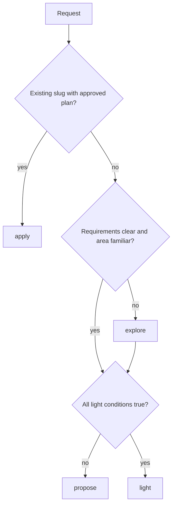

# Choose light, propose or explore

[Русский](../../ru/guides/light-or-propose.md)

Specadoc has three modes that start work on a request: `explore`, `light` and `propose`. `apply` and `archive` continue a change that `propose` made. This guide helps you select the start mode.

## The three modes

| | explore | light | propose |
|---|---|---|---|
| Purpose | Find facts and test the idea | Make a small change in one session | Make a change with a full record |
| Files it writes | None | Capability specs and code | Change folder (`spec.md`, `plan.md`), then code |
| Approval | None | One approval in chat | Plan checkpoint, recorded in `plan.md` |
| Roles | At most one `scout` | One `reviewer`, unless the diff is trivial | `scout`, `worker`, `reviewer` |
| Next step | `propose` or `light` | None. Light has no archive step | `apply`, then `archive` |

Explore returns a decision log, safe defaults and at most three material questions. It writes nothing to the repository.

Light keeps the plan, the approval and the evidence in the conversation. It changes the capability specs under `docs/specadoc/specs/` in place. It makes no change folder, no `runs/` folder and no archive record.

Propose writes the spec and the plan and stops at the plan checkpoint. For the full path, see [Your first change](first-change.md).

## Light eligibility

A change can use light only if all of these conditions are true:

- The change is in one repository, and the work fits one session.
- The requirements are clear, and no material domain question is open.
- No contract with consumers outside this repository changes: a published API, an SDK, an event or a shared schema.
- The change does not touch money handling or the permission model.
- The change has no irreversible data effect. An ordinary additive migration is permitted.

If one condition is false, use `propose`. If the requirements are not clear, use `explore` first.

The agent checks the conditions again when new facts appear. If a condition becomes false during light, the agent stops and switches to `propose`. Propose keeps the approved spec delta and the accepted evidence and records them in `spec.md`. The work does not start again.

## How Specadoc selects a mode

You can always name the mode. An explicit mode wins. If you do not name a mode, the agent uses these rules in this order:

1. If the slug names an existing change with a recorded plan approval, it selects `apply`. Plan approval is the only approval stop.
2. If material requirements are not clear, or the area is unfamiliar, it selects `explore`.
3. If one light condition is false, it selects `propose`.
4. In all other cases, it selects `light`. This includes small local fixes.

The agent never selects `archive` on its own.

## What you decide in light

Light has one stop. The agent shows one compact preview in chat:

- the spec delta: the changed `C<n>` statements of the capability specs
- the files to change and the ordered steps
- the exact verification commands, including the static analysis and style gates of the repository
- the risk
- the controller and reviewer bindings

Your approval covers the spec and the plan together. If you asked for uninterrupted work, the agent does not stop. The spec delta stays in the preview.

After the approval, the controller writes the code test-first and runs the final verification once. Then one independent `reviewer` reads the spec delta, the diff and the evidence. The controller skips the reviewer only for a trivial diff: one file and no behavior change. If no subagent can start, the agent reports that the review gate is incomplete. It never reviews its own diff.

To close, the agent adds a provenance row (`<slug> | <date> | <effect>`) to each changed capability file and runs `doctor.py` once. It commits only when you ask.

If a light change stops before the end, the edited specs and the working tree hold its state. The agent continues from `git diff` and the spec delta.

## Examples

The examples below are invented. They show how the conditions apply.

| Request | Mode | Reason |
|---|---|---|
| Fix the page count in the admin list of users. The last page shows one extra empty row. | light | One repository, clear behavior, no outside consumer |
| Add a `--since <date>` option to the internal `report export` command. | light | Clear requirement. Only this repository uses the command |
| Add a nullable column `archived_at` and show it in the admin list. | light | An additive migration is permitted |
| Add a `currency` field to the public `GET /orders/{id}` response. | propose | A published API changes for outside consumers |
| Change how refunds round to cents. | propose | Money handling changes |
| Drop the `legacy_notes` column and its data. | propose | Irreversible data effect |
| Let support agents see invoices of other teams. | propose | The permission model changes |
| Move the export to a background job and add a progress bar. | propose | The work does not fit one session |
| "Search is slow. Make it faster." | explore | The requirement is not clear: which search, how slow, what target |
| Change an event that a service in another repository reads. | propose | Another repository consumes the contract |

For the last example, each repository gets its own change. If several controllers must work together, see [Orchestrator and foreman](orchestrator-and-foreman.md).

## When explore comes first

If you cannot write the acceptance scenarios yet, use `explore`. Explore searches the capability specs for the request and reads at most three matching files. If the code and a capability spec disagree, the code wins, and explore reports the drift.

Explore can start one `scout` with one concrete question, for example when the area is unfamiliar. It can also do a stress test of the idea with a grilling skill, if your host has one. For when it does this, see the [explore reference](../../../skills/specadoc/references/explore.md).

Keep explore and the next `propose` in the same session. Propose reuses the explore evidence and does not repeat the investigation.

## Related pages

- [Modes reference](../reference/modes.md)
- [Lifecycle](../concepts/lifecycle.md)
- [Artifacts and gates](../concepts/artifacts-and-gates.md)
