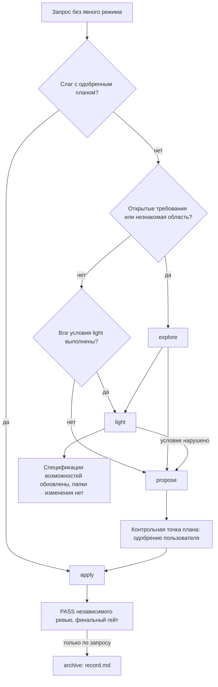

<!-- source-sha256: 7c0d2ca3cbd3898ac1d3659a684673a66c785f176d604ac0248c799f57b04337 -->
# Жизненный цикл

[English](../../en/concepts/lifecycle.md)

Specadoc ведёт одно изменение через фиксированную последовательность режимов.
У каждого режима одна задача и заранее определённая точка остановки. Specadoc
запускается, только когда вы называете его или один из его режимов. К обычной
работе с кодом он себя не применяет.

Режимов пять. `explore`, `propose`, `apply` и `archive` составляют полный
жизненный цикл. `light` — короткий путь для небольшого изменения, которое
укладывается в одну сессию.

В командах ниже `<skill-root>` — установленная папка `skills/specadoc`.

## Схема

Явный режим пропускает выбор в верхней части схемы. `archive` никогда не
выбирается автоматически.

## explore

`explore` устанавливает факты и проверяет идею, пока никто ещё не пишет файлы.
Доказательства остаются в разговоре, а не в репозитории.

Сначала контроллер ищет спецификации возможностей, которые подходят к запросу.
Он читает не больше трёх из них и никогда не читает архив, потому что архивные
записи — закрытая история. Если код и спецификация возможности расходятся,
прав код, а о расхождении контроллер сообщает.

Для широкой или незнакомой области контроллер отправляет один `scout` только
для чтения с одним конкретным вопросом. Порог — около пяти файлов или 400 строк
чтения. Когда факты устоялись, идею может проверить на прочность скилл вроде
grilling. Контроллер берёт его, если открыто больше одного существенного
вопроса или доказательства противоречат друг другу. Ещё он берёт его, когда
изменение затрагивает публичный контракт, схему, безопасность, конкурентный
доступ или деньги.

Итог — журнал решений, безопасные значения по умолчанию и не больше трёх
существенных вопросов к вам.

## propose

`propose` превращает принятые доказательства в два файла в папке изменения:
`spec.md` и `plan.md`. Он переиспользует доказательства из `explore` и не
повторяет разведку.

Порядок такой:

1. Scout составляет карту кода, который предстоит изменить. `init_change.py`
   создаёт папку изменения.
2. Контроллер заполняет спецификацию: требования, сценарии приёмки, не-цели,
   ограничения, допущения и операции над возможностями.
3. Запускается гейт спецификации (`validate_change.py <slug> --phase spec`).
4. Контроллер пишет небольшой упорядоченный набор задач, обычно от трёх до
   восьми. У каждой задачи есть владелец: `worker` или `controller`.
5. Если план добавляет новые нетестовые файлы, запускается гейт дизайна.
6. Запускается гейт плана (`--phase plan`). Контроллер показывает компактный
   предпросмотр с привязками ролей и наблюдаемым размером контекста.
7. Жизненный цикл останавливается, чтобы вы одобрили план. Эта остановка и
   есть контрольная точка плана.

Контрольная точка плана — единственная остановка для одобрения во всём полном
жизненном цикле. Явная просьба выполнить работу без остановок её отменяет.
Гейт спецификации и гейты проверки такая просьба не отменяет никогда.

Файлы и гейты описаны на странице [Артефакты и гейты](artifacts-and-gates.md).

## apply

`apply` реализует одобренный план и собирает финальные доказательства. Без
проверенных спецификации и плана и без записанного одобрения он не запускается.

Для каждой задачи контроллер запускает `specadoc_step.py dispatch`. Worker
реализует задачу по циклу RED-GREEN-REFACTOR и пишет отчёт. Контроллер
запускает `accept`: этот шаг выполняет поле `Verification` задачи и проверяет
её границы. Только после этого начинается следующая задача. Отправка задачи
ещё не означает приёмку.

После последней задачи контроллер один раз запускает весь набор тестов и
гейты репозитория. Затем один независимый `reviewer` только для чтения
проверяет стабильный дифф. Подтверждённые замечания исправляют, и после этого
проходит одно целевое повторное ревью.

При PASS контроллер обновляет спецификации возможностей, которые названы в
спецификации. Он заполняет сводку для архива и запускает финальный гейт
(`--phase final`). `apply` не архивирует изменение. Архивацию вы запрашиваете
отдельно.

## archive

`archive` закрывает изменение в один компактный `record.md` в
`<root>/archive/<slug>/`. Он запускается только по явному запросу.

Archive использует PASS, который записал `apply`. Новое ревью он не начинает.
Сначала он проверяет, что PASS всё ещё покрывает текущий исполняемый дифф. Если
после PASS изменились код, тесты или одобренные требования, archive
останавливается, и изменение возвращается в `apply`.

Прогон archive может выполнить worker. Решение остаётся за контроллером, и он
проверяет результат. Скрипт публикует запись, читает её обратно и только потом
удаляет папку изменения.

## light

`light` нужен для небольшого изменения, которое укладывается в одну сессию. Он
не создаёт ни папку изменения, ни `plan.md`, ни папку `runs/`, ни архивную
запись. Scout и worker он не отправляет. Долговременная запись — спецификации
возможностей. План, одобрение и доказательства остаются в разговоре.

Должны выполняться все условия ниже. Контроллер проверяет их снова, когда
появляются новые факты:

- Один репозиторий, и работа укладывается в одну сессию.
- Требования ясны, открытых существенных вопросов о предметной области нет.
- Нет изменений контракта, у которого есть потребители вне репозитория
  (опубликованный API, SDK, событие или общая схема).
- Нет изменений в работе с деньгами или в модели прав доступа.
- Нет необратимого воздействия на данные сверх обычной добавляющей миграции.

Контроллер правит затронутые спецификации возможностей на месте и показывает в
чате один предпросмотр. Одно одобрение покрывает и дельту спецификации, и план.
Контроллер сам реализует изменение и один раз выполняет финальную проверку.

Дифф проверяет один независимый reviewer, кроме тривиального случая (один
файл, поведение не меняется). Если запускать субагентов нельзя, гейт ревью
остаётся незавершённым. Контроллер никогда не проверяет собственную работу.

При закрытии в каждую затронутую спецификацию возможности добавляется строка
происхождения. Шага архивации нет.

Если условие нарушено, `light` останавливается и переходит в `propose`. Если
появился открытый вопрос, он переходит в `explore`. Одобренная дельта
спецификации и принятые доказательства переносятся в `spec.md`. Работа не
начинается заново.

Прерванное лёгкое изменение — это отредактированные спецификации и рабочее
дерево. Следующая сессия продолжает работу по `git diff` и дельте
спецификации.

Практическое сравнение режимов есть на странице
[Light или propose](../guides/light-or-propose.md).

## Как выбирается режим

Явный режим всегда побеждает. Если его нет, Specadoc применяет эти правила по
порядку:

1. `apply`, только для существующего слага, в плане которого записано
   одобрение плана.
2. `explore`, когда существенные требования открыты или область незнакома.
3. `propose`, когда не выполнено хотя бы одно условие `light`.
4. `light` во всех остальных случаях, включая небольшие локальные исправления.

`archive` в этом списке нет. Для него всегда нужен явный запрос.

## Непрерывность активного изменения

После того как вы выбрали изменение, следующие запросы остаются в его
жизненном цикле. Сюда входят небольшие визуальные правки, исправления по
итогам проверки и продолжение реализации. Контроллер ведёт одно активное
изменение за раз.

Пока поведенческие требования не меняются, контроллер переиспользует принятые
спецификацию и план, доказательства scout и одобрения. Новые доказательства
добавляются в существующий план. Новый план не заводится.

Записанный PASS остаётся действительным для `archive` после правок плана,
спецификаций возможностей, сводки для архива, учёта токенов или архивной
записи. Изменение любого пункта ниже требует финального `apply` с новым ревью:

- продакшн-код, тесты или миграции
- исполняемая конфигурация
- публичные контракты
- одобренные требования

Небольшая доработка самим контроллером может заменить worker по правилам
маршрутизации. Финальную проверку и независимое ревью нового исполняемого
диффа она не заменяет никогда.

## Когда начинается новый жизненный цикл

Новый жизненный цикл начинайте только для другого изменения или для
изменённого поведенческого контракта.

Новые требования могут попасть и в активное изменение. Тогда контроллер
сначала заново открывает ревью спецификации и не переписывает принятые
требования под код. Следующий раунд ревью в этом случае будет раундом
`initial` с причиной `requirements`, а не `re-review`.

Архивная запись — закрытая история, её никогда не открывают повторно. Чтобы
изменить поведение из архива, откройте новое изменение.

## Связанные страницы

- [Роли](roles.md)
- [Артефакты и гейты](artifacts-and-gates.md)
- [Справочник режимов](../reference/modes.md)
- Подробности для агентов: [explore](../../../skills/specadoc/references/explore.md),
  [propose](../../../skills/specadoc/references/propose.md),
  [apply](../../../skills/specadoc/references/apply.md),
  [light](../../../skills/specadoc/references/light.md),
  [archive](../../../skills/specadoc/references/archive.md)
