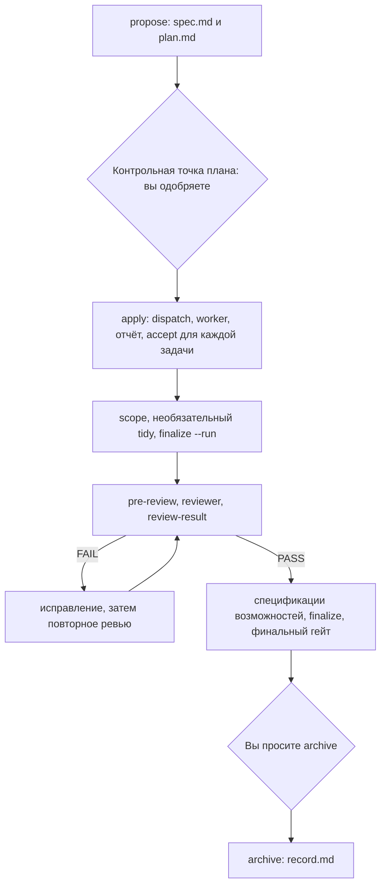

<!-- source-sha256: 28cbb1828fc3aaeb4770b1bfdd4d41c018848f2d1b42ce73b7c0b12d1b59e969 -->
# Ваше первое изменение

[English](../../en/guides/first-change.md)

Это руководство проводит одно изменение от `propose` до `archive`. Оно показывает, что вы вводите, какие файлы появляются и что вы решаете на каждой остановке.

Контроллер (ваша основная сессия агента) запускает скрипты. Вы читаете их вывод и принимаете решения. Ниже показаны команды, которые запускает контроллер. По ним можно прочитать тот же вывод или самому запустить шаг, который только читает файлы.

`<skill-root>` — установленная папка `skills/specadoc`. Как её найти, описано в разделе [Установка Specadoc](install.md#проверка-установки).

## Пример

> **Только пример.** Проект `shop-api`, его файлы и тесты придуманы для этого руководства.

`shop-api` — веб-сервис на Python. В его таблице `orders` уже есть столбец `currency`, но публичный ответ `GET /orders/{id}` его не показывает. Запрос:

> Добавить валюту заказа (код ISO 4217) в ответ `GET /orders/{id}`.

Опубликованный API меняется для внешних потребителей, поэтому режим light не подходит. См. [Выбор light, propose или explore](light-or-propose.md).

## Путь



## 1. Запустите propose

Введите режим и запрос:

- Claude Code: `/specadoc:specadoc propose Add the order currency to the GET /orders/{id} response`
- Плагин Codex: `$specadoc:specadoc propose ...` или выберите скилл и введите `propose ...`
- Обычный скилл: `Use specadoc propose ...`

Сначала контроллер запускает `scout`. Scout находит код для изменения и внешний контракт. Затем контроллер создаёт папку изменения:

```bash
python3 <skill-root>/scripts/init_change.py order-currency-field --risk high --with-design --scout <scout agent id>
```

Появляются такие файлы:

```text
docs/specadoc/order-currency-field/
  spec.md     stable behavioral contract
  plan.md     tasks, approvals, evidence
  design.md   only when the artifact rules need it
```

В этом примере меняется публичный API, поэтому правила требуют и `design.md`, и контроллер добавляет `--with-design`. Файл `research.md` появляется, только когда доказательства не помещаются в `plan.md` в краткой форме. Правила описаны на странице [Артефакты и гейты](../concepts/artifacts-and-gates.md).

## 2. Прочитайте спецификацию

Контроллер заполняет `spec.md` и запускает `validate_change.py order-currency-field --phase spec`, пока проверка не пройдёт. Прочитайте эти разделы:

| Раздел | Что проверить |
|---|---|
| Goal, Non-goals | Объём, который вы просили, и ничего сверх него |
| Requirements | `R1`, `R2`: наблюдаемое поведение, которое можно проверить тестом. Без имён классов и путей к файлам |
| Acceptance scenarios | `A1` с Given, When, Then и строкой `Covers:` |
| Affected capabilities | Операции над спецификациями возможностей, например `ADDED C4 (R1)` |
| Assumptions | Безопасные значения по умолчанию, которые агент выбрал за вас |

Пример требования и сценария:

```markdown
### R1 — Order response shows the currency

`GET /orders/{id}` returns `currency`, the ISO 4217 code of the order.

### A1 — Existing order in euros

**Covers:** R1

- **Given:** an order with currency EUR
- **When:** a client requests `GET /orders/{id}`
- **Then:** the response contains `"currency": "EUR"`
```

Если требование неверно, скажите об этом сейчас. Изменение спецификации после одобрения требует нового одобрения.

## 3. Одобрите план в контрольной точке

Контроллер записывает задачи и запускает `validate_change.py order-currency-field --phase plan`. Если план добавляет новые нетестовые файлы, сначала независимый reviewer проверяет `## Class inventory` (гейт дизайна). Этот пример не добавляет новых нетестовых файлов, поэтому гейт не применяется.

Затем контроллер останавливается и показывает краткое превью. В превью примера такая таблица задач:

| Task | Outcome | Files | Owner | Direction | Verification |
|---|---|---|---|---|---|
| T1 | Ответ заказа показывает валюту | `app/api/orders.py`, `tests/api/test_orders.py` | worker | Добавить поле в сериализатор ответа | `pytest tests/api/test_orders.py` |
| T2 | Схема OpenAPI совпадает с ответом | `openapi.yaml`, `tests/contract/test_openapi.py` | worker | Добавить `currency` в схему заказа | `pytest tests/contract/test_openapi.py` |

Под таблицей превью показывает по одной строке на роль (controller, scout, worker, reviewer): рантайм, модель, уровень усилий и исходный файл. Ещё превью показывает текущий размер контекста из `status`.

Перед одобрением проверьте:

1. У каждого требования есть задача и точная проверка в матрице требований и проверок.
2. Каждая задача — результат, который можно проверить отдельно. «Добавить тесты» — не задача.
3. Каждое поле `Verification` — точная команда, которая работает в вашем репозитории.
4. У задачи с `Owner: worker` задано `Decision risk: low`. Остальные задачи остаются у контроллера, и для них указана причина.
5. Проверка, которую можете выполнить только вы или другой человек, записана в `External verification:`.
6. Привязки ролей соответствуют риску. Превью может содержать одну строку совета по привязке.

Specadoc не выбирает модели. Модель и уровень усилий роли берутся из файла роли. Если привязка не подходит, сами измените файл роли или `.specadoc.json`. См. [Маршрутизация](routing.md).

Чтобы одобрить план, ответьте в чате. Контроллер записывает ваши слова:

```bash
python3 <skill-root>/scripts/specadoc_step.py approve order-currency-field --by user --source 'Approved in chat: "go ahead"'
```

Шаг записывает одобрение в `plan.md` и сохраняет хеши `spec.md` и `design.md` в `runs/approval.json`. Контрольная точка плана — единственная остановка для одобрения. Если вы просили работать без остановок, контроллер здесь не останавливается. Он всё равно записывает спецификацию и план и запускает их гейты.

Если `status` советует новую сессию, запустите `apply` в новой сессии. Новая сессия читает список `### Read before continuing` в `plan.md`.

## 4. Apply

Введите: `/specadoc:specadoc apply order-currency-field`.

### Задачи

Для каждой задачи контроллер выполняет четыре шага:

1. `specadoc_step.py dispatch order-currency-field T1` проверяет задачу и записывает базовый снимок и бриф задачи (`runs/T1-brief.md`).
2. `worker` читает бриф и пишет сначала тест, потом код.
3. Worker завершает работу командой `specadoc_step.py report order-currency-field T1 --status DONE --summary ... --red ... --green ...`.
4. `specadoc_step.py accept order-currency-field T1` проверяет границы задачи, запускает `Verification` задачи и записывает доказательства.

Каждый шаг выводит пять полей. Успешный `accept` выглядит так:

```text
checked: check-scope; pytest tests/api/test_orders.py; check-scope after verification
result: ACCEPTED
changed files: app/api/orders.py, tests/api/test_orders.py
blocking reason: -
next: task evidence and accepted result saved; continue with the next ready task
```

Другие результаты `accept`:

| Результат | Значение | Кто действует |
|---|---|---|
| `NEEDS_DECISION` | Worker сообщил о сомнениях | Контроллер решает и снова запускает `accept` с `--note`. Если сомнение касается продуктового решения, контроллер спрашивает вас |
| `EXTERNAL-PENDING` | У задачи есть `External verification:` | Проверку выполняете вы или другой исполнитель. Контроллер записывает результат через `external-result` |
| `FAIL` | Команда завершилась с ошибкой, или файл вне границ задачи | Контроллер исправляет задачу или возвращает её worker |
| `BLOCKED` | Гейт не может выполниться | См. [Устранение неполадок](troubleshooting.md) |

Состояние изменения можно посмотреть в любой момент:

```bash
python3 <skill-root>/scripts/specadoc_step.py status order-currency-field
```

`status` только читает файлы. Его строка `next:` называет следующий разрешённый шаг.

### Финальная проверка

После последней задачи контроллер готовит ревью:

1. `specadoc_step.py scope order-currency-field` записывает `## Review scope` по диффу от `HEAD`. Если в дереве есть посторонние правки, исключите их через `--exclude <path>`.
2. Один worker может выполнить проход tidy без изменения поведения (`specadoc_step.py tidy order-currency-field`). Затем контроллер запускает `specadoc_step.py refresh order-currency-field`. Если `.specadoc.json` задаёт `review.tidy: required`, этот проход обязателен.
3. `specadoc_step.py finalize order-currency-field --run` один раз запускает полный набор тестов и гейты из `verification.final` в `.specadoc.json`. Если этого ключа нет, контроллер запускает их сам и записывает результат через `--observed '<command, result>'`.

### Ревью

1. `specadoc_step.py pre-review order-currency-field` записывает раунд `G1`. Шаг записывает для reviewer файлы `runs/G1-head.diff` и `runs/G1-status.txt`.
2. Новый `reviewer`, который только читает, проверяет полноту, правильность, согласованность и риск регрессии.
3. `specadoc_step.py review-result order-currency-field --from-agent <id>` сохраняет ответ дословно в `runs/`.

Reviewer выносит вердикт, PASS или FAIL, и даёт замечания: BLOCKER, IMPORTANT или MINOR.

- Если вердикт FAIL, worker исправляет подтверждённые замечания (`dispatch order-currency-field T1 --reopen '<reason>'`). Затем контроллер запускает одно целевое повторное ревью (`pre-review --review-type re-review`). Контроллер не ждёт вас.
- Если повторное ревью находит новое замечание BLOCKER или IMPORTANT, контроллер останавливается и спрашивает вас.
- Если вердикт PASS с замечаниями MINOR, эти замечания тоже исправляют. Исправление только в тестах или тексте не требует нового раунда. Исправление исполняемого кода получает worker, и после него проходит одно повторное ревью с `--reason minor-fixes`.
- Замечание MINOR остаётся открытым, только если так решили вы. Контроллер записывает его как остаточный риск.

Допускаются три раунда `initial`. Повторные ревью не считаются. Для четвёртого раунда `initial` нужно ваше решение, его передают через `--review-decision`.

### Закрытие изменения

После PASS контроллер:

1. Обновляет каждую спецификацию возможности, которую называет `spec.md`, и добавляет строку происхождения для `order-currency-field`.
2. Заполняет `## Archive summary` и остаточные риски в `plan.md`.
3. Запускает `specadoc_step.py finalize order-currency-field`. Этот шаг отмечает доказанные пункты и заполняет `## Completion evidence`.
4. Запускает `validate_change.py order-currency-field --phase final`.

Финальный гейт выводит `order-currency-field: phase final passes structural validation`. Контроллер сообщает точные команды и результаты. Он делает коммит, только когда вы просите.

## 5. Archive

Архивация — отдельный запрос. Агент никогда не запускает её сам. Введите:

```text
/specadoc:specadoc archive order-currency-field
```

Контроллер проверяет PASS и закрытые гейты. Worker выполняет архивацию:

```bash
python3 <skill-root>/scripts/archive_change.py order-currency-field --dry-run
python3 <skill-root>/scripts/archive_change.py order-currency-field
```

Пробный запуск выводит цель и размер:

```text
would compact docs/specadoc/order-currency-field -> docs/specadoc/archive/order-currency-field/record.md
size: <source bytes> -> <record bytes> bytes
record: valid (schema, slug, required sections; <record bytes> <= 16384 bytes)
```

Вторая команда записывает `docs/specadoc/archive/order-currency-field/record.md` и удаляет папку изменения. Запись хранит результат, дельту возможностей, решения, ревью, итоги по токенам и манифест SHA-256 исходных файлов. Заметки о ходе работы и журналы в запись не попадают.

Если код изменился после PASS, архивация останавливается. Изменение возвращается в `apply` для нового ревью. Обойти это можно только флагом `--force` и только по вашей явной просьбе. Принудительно созданная запись сохраняет невыполненные гейты. Ограничения `--force` описаны в [справочнике по archive](../../../skills/specadoc/references/archive.md).

## Связанные страницы

- [Жизненный цикл](../concepts/lifecycle.md)
- [Роли](../concepts/roles.md)
- [Справочник по скриптам](../reference/scripts.md)
- [Структура плана](../reference/plan-structure.md)
- [Устранение неполадок](troubleshooting.md)
