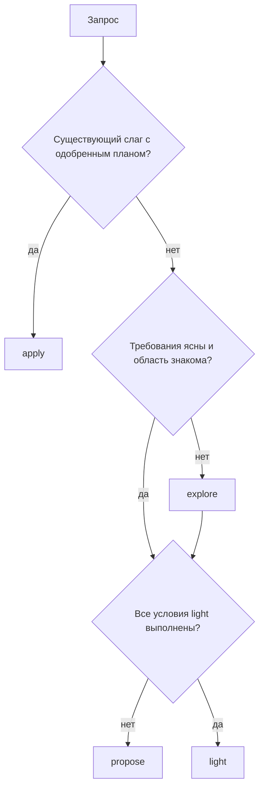

<!-- source-sha256: cab067dd5d645850839894516bc3f9bdf60082a6a7aa00f5e882effcc36fcfcd -->
# Выбор light, propose или explore

[English](../../en/guides/light-or-propose.md)

Работу над запросом в Specadoc начинают три режима: `explore`, `light` и `propose`. `apply` и `archive` продолжают изменение, которое создал `propose`. Это руководство помогает выбрать начальный режим.

## Три режима

| | explore | light | propose |
|---|---|---|---|
| Назначение | Найти факты и проверить идею | Сделать небольшое изменение за одну сессию | Сделать изменение с полной записью |
| Какие файлы пишет | Никаких | Спецификации возможностей и код | Папку изменения (`spec.md`, `plan.md`), затем код |
| Одобрение | Нет | Одно одобрение в чате | Контрольная точка плана, одобрение записано в `plan.md` |
| Роли | Не больше одного `scout` | Один `reviewer`, если дифф не тривиальный | `scout`, `worker`, `reviewer` |
| Следующий шаг | `propose` или `light` | Нет. У light нет шага архивации | `apply`, затем `archive` |

Explore возвращает журнал решений, безопасные значения по умолчанию и не больше трёх существенных вопросов. В репозиторий explore ничего не записывает.

Light хранит план, одобрение и доказательства в чате. Он меняет спецификации возможностей в `docs/specadoc/specs/` на месте. Он не создаёт папку изменения, папку `runs/` и архивную запись.

Propose записывает спецификацию и план и останавливается в контрольной точке плана. Полный путь описан на странице [Ваше первое изменение](first-change.md).

## Когда можно использовать light

Изменение может идти через light, только если выполнены все эти условия:

- Изменение затрагивает один репозиторий, и работа помещается в одну сессию.
- Требования ясны, и нет открытых существенных вопросов о предметной области.
- Не меняется контракт с потребителями вне этого репозитория: опубликованный API, SDK, событие или общая схема.
- Изменение не затрагивает работу с деньгами и модель прав доступа.
- У изменения нет необратимых последствий для данных. Обычная миграция, которая только добавляет, допустима.

Если одно условие не выполнено, используйте `propose`. Если требования неясны, сначала используйте `explore`.

Агент проверяет условия снова, когда появляются новые факты. Если во время light условие перестаёт выполняться, агент останавливается и переходит в `propose`. Propose сохраняет одобренную дельту спецификации и принятые доказательства и записывает их в `spec.md`. Работа не начинается заново.

## Как Specadoc выбирает режим

Вы всегда можете назвать режим. Явно названный режим имеет приоритет. Если вы не назвали режим, агент применяет эти правила по порядку:

1. Если слаг называет существующее изменение с записанным одобрением плана, агент выбирает `apply`. Одобрение плана — единственная остановка для одобрения.
2. Если существенные требования неясны или область незнакома, агент выбирает `explore`.
3. Если одно условие light не выполнено, агент выбирает `propose`.
4. Во всех остальных случаях агент выбирает `light`. Сюда входят небольшие локальные исправления.

Агент никогда не выбирает `archive` сам.

## Что вы решаете в light

У light одна остановка. Агент показывает в чате одно краткое превью:

- дельту спецификации: изменённые утверждения `C<n>` в спецификациях возможностей
- файлы для изменения и шаги по порядку
- точные команды проверки, включая гейты статического анализа и стиля репозитория
- риск
- привязки контроллера и reviewer

Ваше одобрение покрывает спецификацию и план вместе. Если вы просили работать без остановок, агент не останавливается. Дельта спецификации остаётся в превью.

После одобрения контроллер пишет сначала тест, потом код, и один раз выполняет финальную проверку. Затем один независимый `reviewer` читает дельту спецификации, дифф и доказательства. Контроллер пропускает reviewer только для тривиального диффа: один файл и никаких изменений поведения. Если ни один субагент не может запуститься, агент сообщает, что гейт ревью не завершён. Агент никогда не проверяет свой собственный дифф.

Чтобы закрыть изменение, агент добавляет строку происхождения (`<slug> | <date> | <effect>`) в каждый изменённый файл возможности и один раз запускает `doctor.py`. Коммит агент делает, только когда вы просите.

Если лёгкое изменение остановилось до конца, его состояние хранят изменённые спецификации и рабочее дерево. Агент продолжает работу по `git diff` и дельте спецификации.

## Примеры

Примеры ниже придуманы. Они показывают, как применяются условия.

| Запрос | Режим | Причина |
|---|---|---|
| Исправить счётчик страниц в админском списке пользователей. На последней странице лишняя пустая строка. | light | Один репозиторий, ясное поведение, нет внешних потребителей |
| Добавить параметр `--since <date>` во внутреннюю команду `report export`. | light | Ясное требование. Команду использует только этот репозиторий |
| Добавить столбец `archived_at`, который допускает NULL, и показать его в админском списке. | light | Миграция, которая только добавляет, допустима |
| Добавить поле `currency` в публичный ответ `GET /orders/{id}`. | propose | Опубликованный API меняется для внешних потребителей |
| Изменить округление возвратов до центов. | propose | Меняется работа с деньгами |
| Удалить столбец `legacy_notes` и его данные. | propose | Необратимые последствия для данных |
| Дать сотрудникам поддержки доступ к счетам других команд. | propose | Меняется модель прав доступа |
| Перенести экспорт в фоновую задачу и добавить индикатор прогресса. | propose | Работа не помещается в одну сессию |
| «Поиск медленный. Сделайте быстрее.» | explore | Требование неясно: какой поиск, насколько медленный, какая цель |
| Изменить событие, которое читает сервис из другого репозитория. | propose | Контракт использует другой репозиторий |

В последнем примере каждый репозиторий получает своё изменение. Если несколько контроллеров должны работать вместе, см. [Orchestrator и foreman](orchestrator-and-foreman.md).

## Когда сначала нужен explore

Если вы пока не можете написать сценарии приёмки, используйте `explore`. Explore ищет запрос в спецификациях возможностей и читает не больше трёх подходящих файлов. Если код и спецификация возможности расходятся, верным считается код, и explore сообщает о расхождении.

Explore может запустить один `scout` с одним конкретным вопросом, например когда область незнакома. Ещё explore может проверить идею на прочность скиллом вида grilling, если такой скилл есть у хоста. Когда explore это делает, описано в [справочнике по explore](../../../skills/specadoc/references/explore.md).

Выполняйте explore и следующий за ним `propose` в одной сессии. Propose использует доказательства из explore и не повторяет исследование.

## Связанные страницы

- [Справочник по режимам](../reference/modes.md)
- [Жизненный цикл](../concepts/lifecycle.md)
- [Артефакты и гейты](../concepts/artifacts-and-gates.md)
